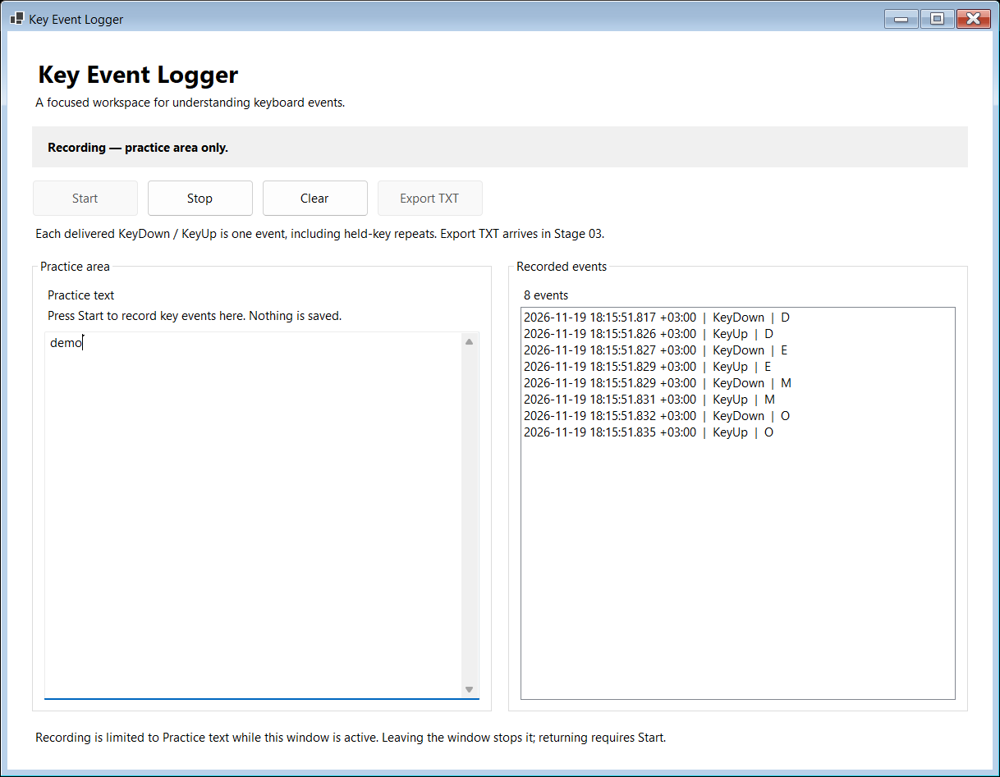
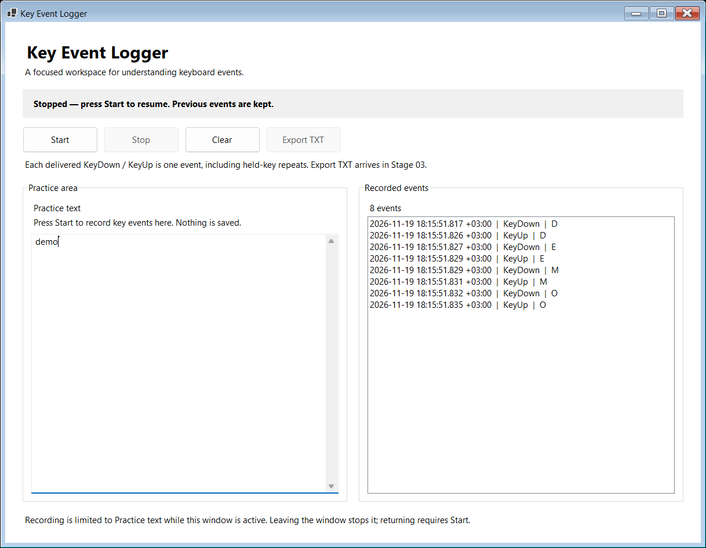

# YMH219 : Key Event Logger

An educational Windows Forms application for **Nesne Tabanlı Programlama (YMH219)**, developed by **Alaa Madi** using C#/.NET 10.

The application demonstrates keyboard events, recording state and timestamps inside its active practice area. User-selected local TXT export is planned for Stage 03.

**Current status: Stage 02 recording, awaiting owner review.** Start, Stop and Clear work with in-memory records. Export TXT remains disabled. Recording is restricted to the practice TextBox while this window is active; leaving or minimizing the window stops it.

## Application screenshots



*Recording: four synthetic demonstration keys produce eight delivered Down/Up events.*



*Stopped: earlier events remain available; resuming requires Start.*

These actual MainForm captures were made at 125% DPI on November 19, 2026 using controlled native input to the application's real event handlers. They are not human keyboard or desktop-focus test evidence. [Capture provenance and checksums](docs/screenshots/README.md) explain the method.

## Controls and behavior

| Control | Behavior |
| --- | --- |
| Start | Begin recording and focus Practice text; retain previous events |
| Stop | Stop collection immediately; retain records |
| Clear | Remove event records/count, preserving recording state and practice text |
| Practice text | Ordinary multiline editing; only its delivered Down/Up events are recorded after Start |
| Event display | Noneditable rows with time, event type and key name |
| Export TXT | Disabled until Stage 03; no file is written |
| Leave or minimize | Stop recording; return/restore requires Start again |

Existing practice text is never inspected or backfilled into records. Starting again does not log what was typed while stopped. Closing discards in-memory data.

## Event policy

Each delivered **KeyDown** or **KeyUp** is one event, including native held-key Down repeats. An ordinary press can produce two rows; the counter counts events, not characters or unique key presses. Delivered modifier events are retained.

Names come from Windows Forms virtual-key names, not translated typed characters. Navigation, shortcuts, keyboard layouts and input methods affect delivery. Tab remains navigation. Down/Up pairs may be incomplete across start, stop, focus or clear boundaries; missing events are not invented.

Rows preserve arrival order and show `yyyy-MM-dd HH:mm:ss.fff zzz` timestamps from the system clock. The domain preserves supplied offsets and does not reorder records if the clock moves backward.

TXT export/error handling follows in Stage 03. Statistics and date/time filtering are deferred.

## Recording scope

This is an application-local event demonstration. It will not use global hooks, observe other applications, run hidden, start with Windows, capture passwords or credentials, save logs automatically, or transmit recorded input. Export will require an explicit local user action. No events are accepted before Start, outside the practice area or after deactivation.

## Getting started

Requirements: Windows 10/11, Git, and the **.NET 10.0.402 SDK**, or a newer stable patch within the 10.0.4xx feature band. The SDK is required; the runtime alone cannot build. The first restore needs access to NuGet. No API key, database, or additional workload is required.

From PowerShell:

```powershell
git clone https://github.com/alaamadii/KeyEventLogger.git
cd KeyEventLogger
./scripts/dev.ps1 doctor
./scripts/dev.ps1 check
./scripts/dev.ps1 run
```

The SDK policy is pinned in `global.json`. The script resolves `dotnet` from PATH, sets DOTNET_ROOT for that invocation, and keeps CLI state under ignored `.local/dotnet`. It restores inherited environment values when finished. See [setup and troubleshooting](docs/SETUP.md).

Open the repository root in VS Code and install the recommended extensions. Use **Ctrl+Shift+B** to build, the **check** task to validate, and **F5** to debug.

## Structure and technology

```text
src/
  KeyEventLogger.App/          Windows Forms UI, local input and lifecycle
  KeyEventLogger.Core/         Immutable records and recording session
tests/
  KeyEventLogger.Core.Tests/   Record/session behavior tests
  KeyEventLogger.App.Tests/    Native STA input/lifecycle/layout tests
scripts/dev.ps1                doctor, restore, build, test, check, run
docs/                          Requirements, design, plan, evidence, submission
.github/                       Windows CI and PR template
.vscode/                       Shared tasks, debugger, extensions
KeyEventLogger.slnx             Solution
global.json                    SDK selection
```

App references Core; Core.Tests references Core; App.Tests references App. Core has no WinForms, drawing, timer, or file-dialog dependency. The UI is programmatic and does not require Designer files.

App and Core have no third-party package dependencies. Both test projects reference `Microsoft.NET.Test.Sdk` 17.14.1, `xunit` 2.9.3, and `xunit.runner.visualstudio` 3.1.4.

## Validation

`./scripts/dev.ps1 check` restores, builds Release, runs available tests, and verifies formatting. Windows CI runs the same command on PRs targeting main and pushes to main.

**38 tests pass: 19 Core and 19 App.** Coverage includes immutable values, protected snapshots, recording transitions, native control messages, focus/minimize/restore boundaries, count/display consistency and layouts. Scripted UI checks use only test-owned windows and synthetic input; they do not establish physical desktop-focus or keyboard acceptance. Executed local checks, UI lifecycle evidence, exact hosted results, and pending manual checks are recorded in [TESTING.md](docs/TESTING.md).

## Development and documentation

Work progresses through one stage branch and PR at a time. The owner reviews and approves merging; the assistant does not merge automatically.

| Guide | Purpose |
| --- | --- |
| [Plan](docs/PLAN.md) | Five stages, deliverables, and acceptance gates |
| [Requirements](docs/REQUIREMENTS.md) | Instructor requirements, owner choices, acceptance criteria |
| [Architecture](docs/ARCHITECTURE.md) | Current scaffold and planned responsibilities |
| [Decisions](docs/DECISIONS.md) | Design rationale and consequences |
| [Setup](docs/SETUP.md) | Tools, commands, SDK policy, troubleshooting |
| [Testing](docs/TESTING.md) | Actual results and planned verification |
| [Development log](docs/DEVELOPMENT.md) | Dated implementation and review history |
| [Submission](docs/SUBMISSION.md) | Course deliverables and remaining owner actions |
| [Working agreement](AGENTS.md) | Repository rules |

## Screenshots and limitations

Two authentic Stage 02 recording/stopped captures are included above. Owner approval and final refresh after export remain pending. The earlier Stage 01 preview is retained only as historical evidence in the capture guide.

TXT export, file error handling, statistics, and filtering are not implemented. Records are kept only in memory; no automatic saving occurs. Human UI/DPI acceptance and another-computer testing remain pending. No distribution package is provided and no license has been selected.

## Course submission

This public repository covers Key Event Logger only. The instructor recommends the repository name `YMH219-KeyEventLogger`; the owner-selected `KeyEventLogger` name is retained.

The supplied assignment specifies **November 30, 2026, 23:59**. Development planning uses Asia/Riyadh; the institution's timezone has not been independently confirmed. The owner submits their GitHub profile link through Classroom. The [submission checklist](docs/SUBMISSION.md) records outstanding requirements and the owner-directed student-number omission.
