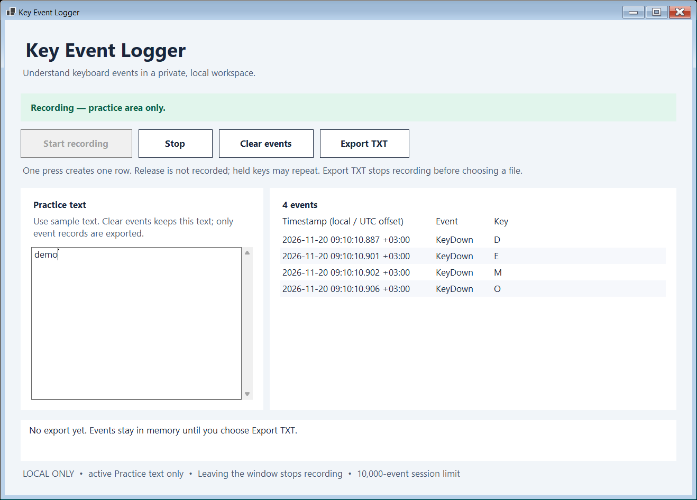
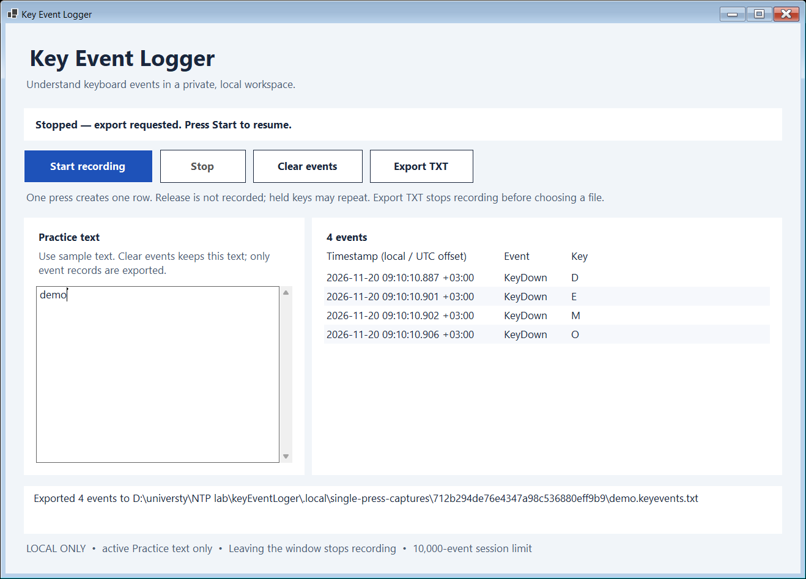

# YMH219 : Key Event Logger

An educational Windows Forms application for **Nesne Tabanlı Programlama (YMH219)**, developed by **Alaa Madi** with C#/.NET 10.

Record key names, event types and timestamps inside the application's active practice area, then explicitly export a local TXT snapshot. The redesigned workspace separates practice text from a readable three-column event table, using the native ListBox required by the assignment.

**Current status:** required application features are implemented. The owner-requested [interface/security review, PR #6](https://github.com/alaamadii/KeyEventLogger/pull/6), is draft for owner review; final course acceptance still requires the remaining manual evidence.

## Application screenshots



*Recording: four demonstration key presses produce four KeyDown records.*



*Export complete: the real file was written, records remain and Start is required to resume.*

These unedited captures show actual source 4725220 at 125% DPI on November 20, 2026. Synthetic native input produced the records. A controlled destination picker selected an isolated local file; the formatter/exporter and checked output were real. They do not prove native Save dialog or human keyboard/desktop-focus acceptance. See [provenance and SHA-256 values](docs/screenshots/README.md).

## Controls

| Action | Behavior |
| --- | --- |
| Start recording / Alt+S | Start explicitly and focus Practice text; retain earlier records |
| Stop / Alt+T | Stop immediately and retain records |
| Clear events / Alt+C | Remove event rows/count; preserve practice text and recording state |
| Practice text / Alt+I | Ordinary native editing; only delivered KeyDown events after Start are recorded |
| Event table | Read-only timestamp, event type and virtual-key columns in arrival order |
| Export TXT / Alt+X | Stop, snapshot, choose a local .txt file and report the write result |
| Leave/minimize | Stop recording; return/restore requires Start |

A short press creates **one KeyDown record**; release does not add a row. Pressing G twice intentionally creates two records. Held keys can repeat KeyDown. Count means delivered press events, not unique keys or reconstructed characters. Navigation, shortcuts, modifiers and input methods affect delivery; Tab remains navigation.

Old practice text and paste content are never inspected or backfilled. The application does not reconstruct typed text.

## Retention and data handling

- At **10,000 events**, recording stops without evicting history. Export if needed, Clear events, then explicitly Start again.
- Native practice entry/paste is limited to **4,096 characters**.
- Clear events preserves practice text. It is not secure memory erasure.
- Closing discards the in-memory session; only explicitly exported files remain.
- Only the application's active focused practice area is recorded. No global hooks, other-app input collection, background monitor, autostart or event transmission is implemented.

Key names/times can still reveal sensitive input. Use sample text, not credentials or personal data. Exports are ordinary plaintext. Read the [user guide](docs/USER_GUIDE.md) and [security/data-handling boundary](docs/SECURITY.md).

## Export format and failure behavior

Export is disabled for empty sessions, while busy and during closing. The owned SaveFileDialog requests overwrite confirmation. Success, cancellation and recoverable errors keep records/count/practice text and remain stopped.

Files use strict UTF-8 without BOM, CRLF, a short header/count and tab-separated Timestamp, EventType and KeyName columns. Export serializes a stable model snapshot, never practice text or table strings. A complete same-folder temporary write precedes replacement; failed writes do not deliberately truncate an existing file.

Choose an existing normal local-drive .txt destination. Network/device paths, reserved names and linked/redirected targets are unsupported. Controlled errors provide retry guidance without exposing raw exception details; success shows the selected path. See [the complete TXT contract and limits](docs/EXPORT.md).

## Setup and run

Requirements: Windows 10/11, Git and **.NET SDK 10.0.402**, or a newer stable patch in the same 10.0.4xx feature band. Restore/audit needs access to official NuGet sources. No API key, database or additional workload is needed.

```powershell
git clone https://github.com/alaamadii/KeyEventLogger.git
cd KeyEventLogger
./scripts/dev.ps1 doctor
./scripts/dev.ps1 check
./scripts/dev.ps1 run
```

Before this review is merged, switch to feat/usability-security-review after cloning to inspect the new UI. Main contains the previously reviewed version.

The script resolves dotnet from PATH, temporarily sets matching DOTNET_ROOT and ignored .local/dotnet CLI state, then restores inherited values/location. Open the repository root in VS Code; Ctrl+Shift+B builds, the check task validates and F5 uses the shared launch configuration. Actual F5 review remains separately pending. See [setup/troubleshooting](docs/SETUP.md).

## Technology and structure

App targets net10.0-windows and owns WinForms, input and file UI/I/O. Core targets net10.0 and owns immutable values, bounded session state and pure formatting. Core.Tests references Core; App.Tests references App. App/Core have no third-party dependencies.

Test tooling is Microsoft.NET.Test.Sdk 17.14.1, xunit 2.9.3 and xunit.runner.visualstudio 3.1.4. global.json pins SDK selection. NuGet.Config fixes official package/audit sources; all-dependency advisory auditing runs during restore with warnings as errors.

```text
src/KeyEventLogger.App/       Form/layout, native input and explicit export
src/KeyEventLogger.Core/      Values, bounded recording session, pure formatter
tests/                       Core and native STA/App/file regressions
scripts/dev.ps1              doctor / restore / build / test / check / run
docs/                        User, security, architecture and evidence guides
.github/                     Windows CI and PR template
.vscode/                     Shared build/check/debug settings
KeyEventLogger.slnx           Solution
```

## Validation

On 2026-11-20, the full local check passed: **94 tests — 30 Core + 64 App**, zero failures/skips/build warnings/errors, formatting clean. Coverage includes focus/stop gates, native G/Space/Back single-press editing, capacity, snapshots, file bytes, failure retention, reserved filenames, controlled error text and layouts.

The dependency query reported no known vulnerable packages in configured sources at that time; this is not a security guarantee. Actual EXE startup/normal close exited 0. Synthetic actual-Form probes checked real export bytes, cancel/read-only failure/retry and window layouts with a controlled picker.

[TESTING](docs/TESTING.md) records exact source/evidence and hosted results separately from human review.

## Documentation and review

| Guide | Purpose |
| --- | --- |
| [User guide](docs/USER_GUIDE.md) | Controls, event semantics, capacity, export and troubleshooting |
| [Security](docs/SECURITY.md) | Data inventory, trust boundary, safeguards and residual limits |
| [Plan](docs/PLAN.md) | Original stages and the owner-requested quality review |
| [Requirements](docs/REQUIREMENTS.md) | Assignment-to-implementation evidence |
| [Architecture](docs/ARCHITECTURE.md) | Actual ownership, input and export flow |
| [Decisions](docs/DECISIONS.md) | Rationale and consequences |
| [Code walkthrough](docs/CODE_GUIDE.md) | Source-linked OOP explanation |
| [TXT export](docs/EXPORT.md) | Exact format, destinations, staging and errors |
| [Setup](docs/SETUP.md) | Tools, commands and debugging |
| [Testing](docs/TESTING.md) | Executed local/hosted/scripted results and pending checks |
| [Development](docs/DEVELOPMENT.md) | Dated work and publication history |
| [Submission](docs/SUBMISSION.md) | Owner procedures and remaining acceptance |
| [Working agreement](AGENTS.md) | Repository rules |

[PR #5](https://github.com/alaamadii/KeyEventLogger/pull/5) was owner-merged. This additional review is independent of that merge; it does not infer missing physical test results. The owner approves merging.

## Limitations and course submission

Physical native Save/overwrite/error review, keyboard/external-app focus review, DPI transitions/F5, assistive technology and another Windows computer remain tracked separately. The new images require owner approval.

Export uses synchronous local I/O and can briefly pause on a slow drive. Path validation is not a filesystem sandbox; exports are not encrypted and OS sync/backup is outside App control. No statistics, filtering, automatic saving, distribution package or license selection is added.

This public repository covers Key Event Logger only; the owner-selected name is retained instead of the recommended YMH219-KeyEventLogger. The assignment specifies **November 30, 2026, at 23:59**; institutional timezone is unconfirmed. The owner submits their GitHub profile link through Classroom.

The student number is omitted by owner direction. The original requirement remains recorded in SUBMISSION; no instructor waiver is claimed.
