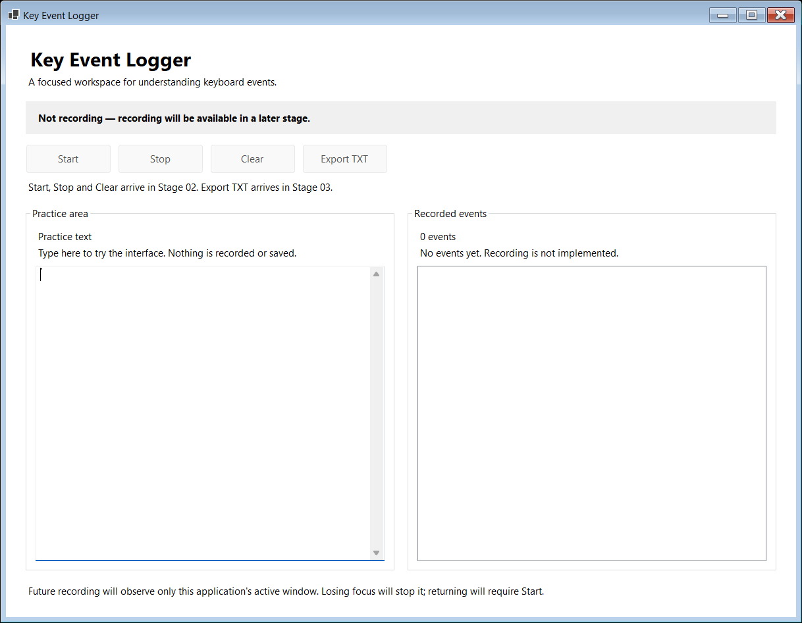

# YMH219 : Key Event Logger

An educational Windows Forms application for **Nesne Tabanlı Programlama (YMH219)**, developed by **Alaa Madi** using C#/.NET 10.

The completed application will demonstrate keyboard events, recording state, timestamps, and user-selected local TXT export. It will observe input only while its own window is active.

**Current status: Stage 01 interface preview, awaiting owner review.** A resizable workspace now includes a practice area, an empty event list, a zero-event count, and an explicit nonrecording status. Start, Stop, Clear, and Export TXT are visible but disabled.

## Interface preview



Actual MainForm capture at 125% DPI on November 19, 2026. This is a UI preview, not evidence of working recording or export. [Capture provenance](docs/screenshots/README.md) records its source and limitations.

| Area | Available now |
| --- | --- |
| Practice text | Ordinary multiline local editing; Tab moves to the event display |
| Recorded events | Empty, noneditable ListBox with a count of zero |
| Status | Clearly states that recording is unavailable |
| Start, Stop, Clear | Disabled; behavior planned for Stage 02 |
| Export TXT | Disabled; behavior planned for Stage 03 |
| Window | Resizable native layout, minimum size, accessible labels and focus |

No practice text is inspected by application logic, added to an event log, saved, or transmitted.

## Planned features

- Show key names, event types, and timestamps in a ListBox or RichTextBox.
- Start and stop recording explicitly; show a clear recording status.
- Stop recording on focus loss and require Start before recording again.
- Clear displayed records and export them to a user-selected local TXT file.
- Handle export errors without terminating the application.

Statistics and date/time filtering are optional and deferred.

## Recording scope

This is an application-local event demonstration. It will not use global hooks, observe other applications, run hidden, start with Windows, capture passwords or credentials, save logs automatically, or transmit recorded input. Export will require an explicit local user action. No keyboard events are recorded in this preview.

## Getting started

Requirements: Windows 10/11, Git, and the **.NET 10.0.402 SDK**, or a newer stable patch within the 10.0.4xx feature band. The SDK is required; the runtime alone cannot build. The first restore needs access to NuGet. No API key, database, or additional workload is required.

From PowerShell:

```powershell
git clone https://github.com/alaamadii/KeyEventLogger.git
cd KeyEventLogger
./scripts/dev.ps1 doctor
./scripts/dev.ps1 check
./scripts/dev.ps1 run
```

The SDK policy is pinned in `global.json`. The script resolves `dotnet` from PATH, sets DOTNET_ROOT for that invocation, and keeps CLI state under ignored `.local/dotnet`. It restores inherited environment values when finished. See [setup and troubleshooting](docs/SETUP.md).

Open the repository root in VS Code and install the recommended extensions. Use **Ctrl+Shift+B** to build, the **check** task to validate, and **F5** to debug.

## Structure and technology

```text
src/
  KeyEventLogger.App/          Windows Forms entry point and resizable UI
  KeyEventLogger.Core/         Independent domain-library scaffold
tests/
  KeyEventLogger.Core.Tests/   Infrastructure; zero domain tests until Stage 02
  KeyEventLogger.App.Tests/    Native STA interface tests
scripts/dev.ps1                doctor, restore, build, test, check, run
docs/                          Requirements, design, plan, evidence, submission
.github/                       Windows CI and PR template
.vscode/                       Shared tasks, debugger, extensions
KeyEventLogger.slnx             Solution
global.json                    SDK selection
```

App references Core; Core.Tests references Core; App.Tests references App. Core has no WinForms, drawing, timer, or file-dialog dependency. The UI is programmatic and does not require Designer files.

App and Core have no third-party package dependencies. Both test projects reference `Microsoft.NET.Test.Sdk` 17.14.1, `xunit` 2.9.3, and `xunit.runner.visualstudio` 3.1.4.

## Validation

`./scripts/dev.ps1 check` restores, builds Release, runs available tests, and verifies formatting. Windows CI runs the same command on PRs targeting main and pushes to main.

**Nine App tests pass; Core still has zero test cases.** Native STA checks cover disabled actions, truthful status, local editing without event collection, noneditable events, tab navigation, minimum/resized layouts, and a blank fresh window. Core remains a scaffold; these tests do not establish recording or export coverage. Executed local checks, UI lifecycle evidence, exact hosted results, and pending manual checks are recorded in [TESTING.md](docs/TESTING.md).

## Development and documentation

Work progresses through one stage branch and PR at a time. The owner reviews and approves merging; the assistant does not merge automatically.

| Guide | Purpose |
| --- | --- |
| [Plan](docs/PLAN.md) | Five stages, deliverables, and acceptance gates |
| [Requirements](docs/REQUIREMENTS.md) | Instructor requirements, owner choices, acceptance criteria |
| [Architecture](docs/ARCHITECTURE.md) | Current scaffold and planned responsibilities |
| [Decisions](docs/DECISIONS.md) | Design rationale and consequences |
| [Setup](docs/SETUP.md) | Tools, commands, SDK policy, troubleshooting |
| [Testing](docs/TESTING.md) | Actual results and planned verification |
| [Development log](docs/DEVELOPMENT.md) | Dated implementation and review history |
| [Submission](docs/SUBMISSION.md) | Course deliverables and remaining owner actions |
| [Working agreement](AGENTS.md) | Repository rules |

## Screenshots and limitations

One authentic interface capture is included above. The final README still needs at least two screenshots showing the completed application's useful behavior.

The controls are presentation only. Key handlers, recording lifecycle, records, clearing behavior, export, statistics, and filtering are not implemented. Human UI/DPI acceptance and another-computer testing remain pending. No distribution package is provided and no license has been selected.

## Course submission

This public repository covers Key Event Logger only. The instructor recommends the repository name `YMH219-KeyEventLogger`; the owner-selected `KeyEventLogger` name is retained.

The supplied assignment specifies **November 30, 2026, 23:59**. Development planning uses Asia/Riyadh; the institution's timezone has not been independently confirmed. The owner submits their GitHub profile link through Classroom. The [submission checklist](docs/SUBMISSION.md) records outstanding requirements and the owner-directed student-number omission.
